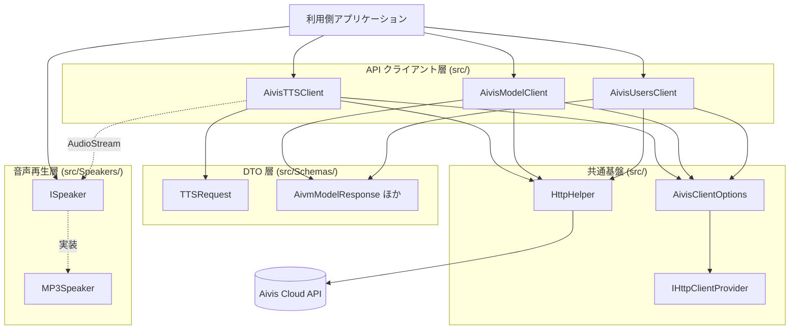
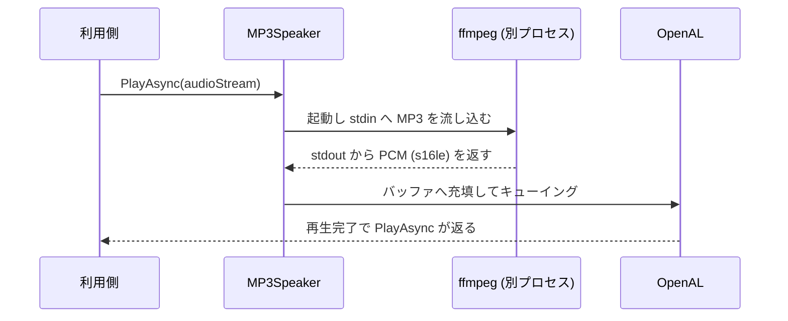

# アーキテクチャ

Aivis.NET の内部構造と設計方針をまとめたドキュメントです。
ライブラリを拡張する場合や、コードを読み解く際の地図として利用してください。

## 全体像

## レイヤごとの責務

### API クライアント層

API の領域ごとに 1 つのクライアントクラスを設けます。命名は `Aivis{領域}Client` です。

| クラス | 対象エンドポイント | 認証 |
|---|---|---|
| `AivisTTSClient` | `POST /v1/tts/synthesize` | 必須 |
| `AivisModelClient` | `/v1/aivm-models/*` | なし（公開エンドポイント） |
| `AivisUsersClient` | `/v1/users/*` | `GetMe` のみ必須 |

いずれもコンストラクタで `AivisClientOptions` を受け取り、`Clone()` した内容を
`private readonly` フィールドに保持します。生成後に外部から設定を書き換えられないようにするためです。

`AivisTTSClient` はコンストラクタ時点で API キーの有無を検証し、未設定なら `ArgumentException` を投げます。
`AivisModelClient` と `AivisUsersClient` は API キーなしでも生成でき、認証が必要なメソッドの呼び出し時に検証します。

### 共通基盤

- **`AivisClientOptions`** — API キー、`BaseUrl`（既定: `https://api.aivis-project.com`）、`HttpClientProvider` を保持します。`ApiKey` は `internal` なので、ライブラリ外からは読み出せません
- **`IHttpClientProvider`** — `HttpClient` の供給元を抽象化します。既定実装の `HttpClientProvider` は単一インスタンスを保持します。テストでは `tests/MockHttpClientProvider.cs` を差し込み、実際の通信を行わずに検証します
- **`HttpHelper`** — `HttpClient` の拡張メソッド（`GetAsync` / `GetWithAuthAsync` / `PostWithAuthAsync`）と、URL 構築・レスポンスヘッダー読み出しのユーティリティを提供します

`HttpHelper.BuildUrl` はクエリ用オブジェクトのプロパティをリフレクションで走査し、
PascalCase をスネークケースへ変換してクエリ文字列を組み立てます。
配列は `tags[0]=...&tags[1]=...` の形式で展開されます。

### DTO 層（`src/Schemas/`）

OpenAPI のコンポーネントスキーマ名をそのままクラス名にしています（例: `AivmModelResponse`、`UserResponseForMe`）。

- シリアライズは `System.Text.Json`
- プロパティ名の対応は `[JsonPropertyName("snake_case")]` で明示
- 文字列 enum は `EnumMemberStringEnumConverter` で `[EnumMember]` の値と相互変換
- 既定値と同じ場合に送信を省略したいプロパティは、`[JsonIgnore]` を付けた公開プロパティと、
  `[JsonInclude]` を付けた非公開のバッキングプロパティに分ける実装になっています（`TTSRequest.StyleId` など）

### 音声再生層（`src/Speakers/`）

`ISpeaker` は `PlayAsync(Stream, CancellationToken)` のみを持つ最小のインターフェイスです。
利用側が独自の再生実装を差し込めるようにするための拡張点で、
Windows 向けに NAudio を使う例は `sample/NAudio/NAudioSpeaker.cs` にあります。

同梱実装の `MP3Speaker` は次のパイプラインで動作します。

- FFmpeg は `FFmpegDecodeOptions.BuildArgs()` が組み立てた引数で起動します（既定は入力 `mp3`、出力 48kHz / 2ch / `pcm_s16le`）
- OpenAL 側はリングバッファ方式で、既定は 4 バッファ × 100ms
- 再生は専用スレッドで行い、完了は `TaskCompletionSource` を通じて `PlayAsync` の呼び出し元へ返されます

## TTS リクエストの流れ

`AivisTTSClient.SynthesizeStreamAsync` を例にした処理の流れです。

1. 引数の `TalkToSpeechOptions`（省略時は既定値のインスタンス）を受け取る
2. `TalkToSpeechOptions` の各値を `Schemas.TTSRequest` に詰め替える
   - `MediaType` / `AudioChannel` は `ToFormatString()` で API の文字列表現に変換
3. `JsonSerializer.Serialize` で JSON 化する
4. `HttpHelper.PostWithAuthAsync` で `Authorization: Bearer <API_KEY>` を付けて送信
5. 成功なら `HttpResponseMessage` をそのまま返し、呼び出し元のメソッドが用途に応じて変換する
   - `SynthesizeAsync` → `byte[]`
   - `SynthesizeStreamAsync` → `Stream`（チャンク転送のままストリーミング再生できる）
   - `SynthesizeWithContentsAsync` → `TTSContents`（`X-Aivis-*` ヘッダーを併せて取得）
6. 失敗ならステータスコードごとに例外へ変換する

### エラーマッピング

`AivisTTSClient` はステータスコードを次のように例外へ変換します。

| ステータス | 例外 | 意味 |
|---|---|---|
| 401 | `UnauthorizedAccessException` | API キーが未設定または無効 |
| 402 | `NotSupportedException` | クレジット残高不足 |
| 404 | `NotSupportedException` | モデルが見つからない |
| 422 | `NotSupportedException` | パラメータ不正 |
| 429 | `NotSupportedException` | レート制限に到達 |
| 500 / 502 / 503 / 504 | `NotSupportedException` | 音声合成サーバー（Citoras）側のエラー |
| その他 | `Exception` | 上記以外の失敗 |

`AivisModelClient` と `AivisUsersClient` は `HttpRequestException` /
`KeyNotFoundException` / `NotSupportedException` / `UnauthorizedAccessException` を使い分けます。

## 入力値の検証方針

API に送る前の妥当性チェックは、原則として `TalkToSpeechOptions` と `SearchVoiceModelsOptions` の
プロパティセッターで行い、範囲外の値は `ArgumentOutOfRangeException` で弾きます。
そのため 422 エラーの多くはライブラリ側で事前に防げます。

一部のプロパティには、値の設定が他のプロパティに波及する相互作用があります。

| 操作 | 副作用 |
|---|---|
| `StyleId` を設定 | `StyleName` が既定値（`ノーマル`）にリセットされる |
| `StyleName` を既定値以外に設定 | `StyleId` が既定値（`0`）にリセットされる |
| `OutputFormat` を `WAV` / `FLAC` に設定 | `OutputBitrate` が `null` にリセットされる |
| `OutputFormat` を変更 | `OutputSamplingRate` の制約が再適用される |
| `OutputFormat` が `OPUS` のとき `OutputSamplingRate` を設定 | 8000/12000/16000/24000/48000Hz のうち、指定値以上で最も近い値に自動調整される |

これらは API 仕様上の排他制約をクライアント側で表現したものです。
新しいオプションを追加する際も、同様にセッターで制約を表現してください。

## 拡張ポイント

| 目的 | 手段 |
|---|---|
| HTTP の挙動を差し替える（リトライ、プロキシ、テスト用モック） | `IHttpClientProvider` を実装し `AivisClientOptions.HttpClientProvider` に設定 |
| 接続先を変える（検証環境など） | `AivisClientOptions.BaseUrl` を設定 |
| 音声再生方法を差し替える | `ISpeaker` を実装 |
| FFmpeg の挙動を変える | `MP3Speaker` に `FFmpegDecodeOptions` を設定 |

## 新しいエンドポイントを追加する手順

1. [OpenAPI 仕様](https://api.aivis-project.com/v1/openapi.json)で対象エンドポイントのスキーマを確認する
2. `src/Schemas/` にリクエスト／レスポンスの DTO を追加する（クラス名は OpenAPI のスキーマ名に合わせる）
3. 該当する領域のクライアントクラスにメソッドを追加する。新しい領域なら `Aivis{領域}Client` を新設する
4. `tests/` に `MockHttpClientProvider` を使ったテストを追加する
5. `CLAUDE.md` のエンドポイント一覧表を更新する
6. 必要に応じて `docs/` にガイドページと `sample/` に実行例を追加する

未実装のエンドポイント（ユーザー辞書 API・課金 API）の一覧は [CLAUDE.md](https://github.com/Atoyr/Aivis.NET/blob/main/CLAUDE.md) にあります。

## 実装と API 仕様の差異

現時点で、公式 API 仕様に対して実装が追いついていない箇所です。修正の際は互換性に注意してください。

| 箇所 | 内容 |
|---|---|
| `use_volume_normalizer` | API には存在するが `TalkToSpeechOptions` / `TTSRequest` のいずれにも未実装。常に API 側の既定値（有効）で動作する |
| `TTSContents.ContentDisposition` | プロパティ名に反して、格納されるのは `Content-Disposition` ヘッダー全体ではなく `HttpHelper.ExtractFileName` が抽出したファイル名 |
| レート制限ヘッダー | 実装は `X-Aivis-Rate-Limit-Remaining` を読むが、API が返すのは `X-Aivis-RateLimit-Requests-Remaining`。`TTSContents.RateLimitRemaining` は常に `0` になる |
| `X-Aivis-RateLimit-Requests-Limit` / `-Reset` | 未取得 |
| `MP3Speaker` の入力形式 | `FFmpegDecodeOptions.InputFormat` の既定が `mp3` 固定のため、`OutputFormat` に `mp3` 以外を指定した音声はそのままでは再生できない |
